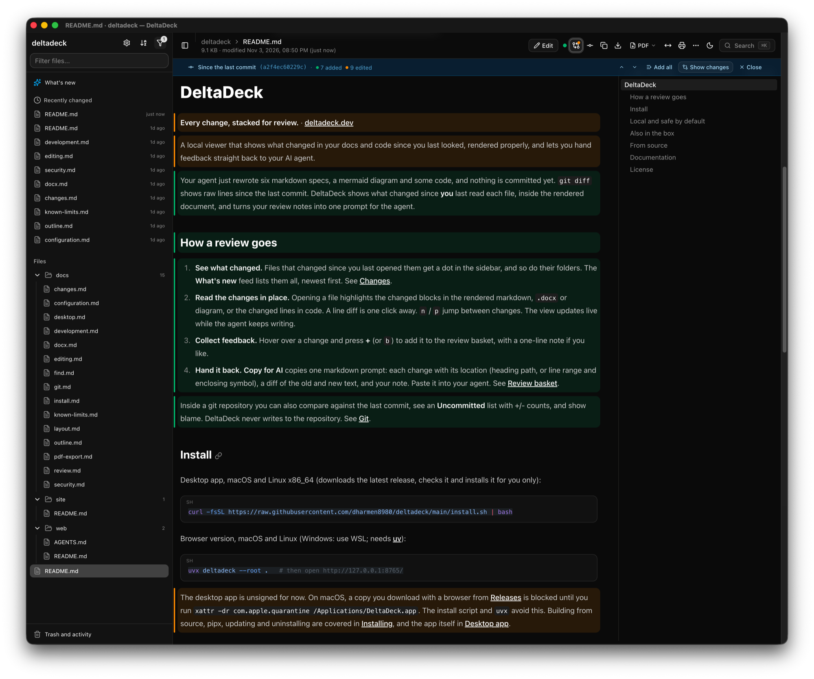

# DeltaDeck

**Every change, stacked for review.** · [deltadeck.dev](https://deltadeck.dev)

A local viewer that shows what changed in your docs and code since you last
looked, rendered properly, and lets you hand feedback straight back to your AI
agent.



Your agent just rewrote six markdown specs, a mermaid diagram and some code,
and nothing is committed yet. `git diff` shows raw lines since the last commit.
DeltaDeck shows what changed since **you** last read each file, inside the
rendered document, and turns your review notes into one prompt for the agent.
It tracks files git never sees too, such as git-ignored agent memory, skills
and plans.

## How a review goes

1. **See what changed.** Files that changed since you last opened them get a
   dot in the sidebar, and so do their folders. The **What's new** feed lists
   them all, newest first. See [Changes](https://github.com/dharmen8980/deltadeck/blob/main/docs/changes.md).
2. **Read the changes in place.** Opening a file highlights the changed blocks
   in the rendered markdown, `.docx` or diagram, or the changed lines in code.
   A line diff is one click away. **`n`** / **`p`** jump between changes. The
   view updates live while the agent keeps writing.
3. **Collect feedback.** Hover over a change and press **+** (or **`b`**) to
   add it to the review basket, with a one-line note if you like.
4. **Hand it back.** **Copy for AI** copies one markdown prompt: each change
   with its location (heading path, or line range and enclosing symbol), a diff
   of the old and new text, and your note. Paste it into your agent. See
   [Review basket](https://github.com/dharmen8980/deltadeck/blob/main/docs/review.md).

Inside a git repository you can also compare against the last commit, see an
**Uncommitted** list with +/- counts, and show blame. DeltaDeck never writes to
the repository. See [Git](https://github.com/dharmen8980/deltadeck/blob/main/docs/git.md).

## Install

Desktop app, macOS and Linux x86_64 (downloads the latest release, checks it
and installs it for you only):

```sh
curl -fsSL https://raw.githubusercontent.com/dharmen8980/deltadeck/main/install.sh | bash
```

Browser version, macOS and Linux (Windows: use WSL; needs [uv](https://docs.astral.sh/uv/)):

```sh
uvx deltadeck --root .   # then open http://127.0.0.1:8765/
```

The desktop app is unsigned for now. On macOS, a copy you download with a
browser from [Releases](https://github.com/dharmen8980/deltadeck/releases) is
blocked until you run
`xattr -dr com.apple.quarantine /Applications/DeltaDeck.app`. The install
script and `uvx` avoid this. Building from source, pipx, updating and
uninstalling are covered in [Installing](https://github.com/dharmen8980/deltadeck/blob/main/docs/install.md), and the app itself in
[Desktop app](https://github.com/dharmen8980/deltadeck/blob/main/docs/desktop.md).

## Local and safe by default

- Everything runs on your machine (`127.0.0.1`). Nothing is uploaded.
- Review history is kept in DeltaDeck's own data dir, never in your folder or
  repository.
- Files open read-only. **Edit** is a button you press per file, and
  `--read-only` removes it altogether. Saves are conflict-checked and keep a
  version history, and deletes go to a Trash. See [Editing](https://github.com/dharmen8980/deltadeck/blob/main/docs/editing.md).
- A short built-in list (`.git`, `node_modules`, `__pycache__`, `.venv`, ...)
  is hidden, but never files git tracks. The eye
  button in the sidebar lists everything hidden; check an item to show it, or
  right-click any file to hide it. Git-ignored files show by default.
  Protected files (`.env`, `.env.*`, `*.pem`, `*.key`) open read-only after a confirmation. See [Layout](https://github.com/dharmen8980/deltadeck/blob/main/docs/layout.md#hidden-files) and the
  [Security model](https://github.com/dharmen8980/deltadeck/blob/main/docs/security.md).

## Also in the box

- **Viewers** for markdown (GFM, table of contents, mermaid, shiki
  highlighting, relative links and images), `.mmd` diagrams, source code with
  line anchors and a [code outline](https://github.com/dharmen8980/deltadeck/blob/main/docs/outline.md), JSON as a tree, CSV and
  xlsx as sortable tables, Word [`.docx`](https://github.com/dharmen8980/deltadeck/blob/main/docs/docx.md) (view-only), images,
  PDFs, and large logs loaded in chunks.
- **Full-text search** across the folder (SQLite FTS5) with folder and type
  filters, plus [find in the file](https://github.com/dharmen8980/deltadeck/blob/main/docs/find.md) with case, whole-word and regex.
- **Deep links** (`/?p=<path>#<heading>` or `#L<line>`), light and dark themes,
  resizable panels and a reading-width menu.
- **Download PDF** for markdown, `.mmd` and `.docx`, rendered by headless
  Google Chrome (see [PDF export](https://github.com/dharmen8980/deltadeck/blob/main/docs/pdf-export.md)).
- **Folders** come from `--root` / `DELTADECK_ROOT`, or are picked with the
  native folder dialog and switched from a list of recent ones (see
  [Configuration](https://github.com/dharmen8980/deltadeck/blob/main/docs/configuration.md#choosing-and-switching-folders)).

Under the hood: a FastAPI server (`server/deltadeck/`) reads the folder and
serves a static Next.js app (`web/`) on `http://127.0.0.1:8765/`. The desktop
app wraps both in Electron.

## From source

Needs [uv](https://docs.astral.sh/uv/) and Node.js:

```sh
git clone https://github.com/dharmen8980/deltadeck.git
cd deltadeck
uv sync
cd web && npm ci && npm run build && cd ..
uv run deltadeck                  # http://127.0.0.1:8765/ (choose a folder in the browser)
uv run deltadeck --root ~/notes   # or start on a given folder
```

See [Development](https://github.com/dharmen8980/deltadeck/blob/main/docs/development.md) for dev mode and tests.

## Documentation

| Topic                                                                                     |                                                                                                                           |
| ----------------------------------------------------------------------------------------- | ------------------------------------------------------------------------------------------------------------------------- |
| [Installing](https://github.com/dharmen8980/deltadeck/blob/main/docs/install.md)          | One-line install, building from source, `uvx` / `pipx`, Releases downloads, updating, uninstalling, where data lives      |
| [Development](https://github.com/dharmen8980/deltadeck/blob/main/docs/development.md)     | Prerequisites, install, build and run, dev mode with hot reload, tests                                                    |
| [Configuration](https://github.com/dharmen8980/deltadeck/blob/main/docs/configuration.md) | Flags and environment variables; choosing and switching folders; `/api/roots`                                             |
| [Editing](https://github.com/dharmen8980/deltadeck/blob/main/docs/editing.md)             | The Edit button, `--read-only`, history, trash, the recovery data dir, backups, limits, how writes are protected    |
| [Changes](https://github.com/dharmen8980/deltadeck/blob/main/docs/changes.md)             | "Changed since you last looked": dots, the filter, the What's new feed, the banner, highlights, where the history is kept |
| [Review basket](https://github.com/dharmen8980/deltadeck/blob/main/docs/review.md)        | Picking highlighted changes, a note each, and copying them as one prompt for an AI agent                                  |
| [Git](https://github.com/dharmen8980/deltadeck/blob/main/docs/git.md)                     | Read-only git views: since last commit, the Uncommitted list, blame; which git is used; `/api/git/*`                      |
| [Find in the file](https://github.com/dharmen8980/deltadeck/blob/main/docs/find.md)       | Cmd/Ctrl+F: shortcuts, what each viewer searches, the editor's search panel, limits                                       |
| [Code outline](https://github.com/dharmen8980/deltadeck/blob/main/docs/outline.md)        | The symbols panel for source code: languages, what is listed, how and when it is computed, bundle size                    |
| [Layout](https://github.com/dharmen8980/deltadeck/blob/main/docs/layout.md)               | Resizing the sidebar and the contents / outline panel, keyboard, reading width, where it is saved                         |
| [Word documents](https://github.com/dharmen8980/deltadeck/blob/main/docs/docx.md)         | How `.docx` files are converted and shown, `/api/docx`, its limits                                                        |
| [PDF export](https://github.com/dharmen8980/deltadeck/blob/main/docs/pdf-export.md)       | How **Download PDF** renders markdown, mermaid and `.docx`                                                                |
| [Desktop app](https://github.com/dharmen8980/deltadeck/blob/main/docs/desktop.md)         | Installing, first launch, data and logs, building the app, desktop mode                                                   |
| [Security model](https://github.com/dharmen8980/deltadeck/blob/main/docs/security.md)     | What the server allows, refuses and why                                                                                   |
| [Known limits](https://github.com/dharmen8980/deltadeck/blob/main/docs/known-limits.md)   | Things that do not work (yet)                                                                                             |

## License

[MIT](https://github.com/dharmen8980/deltadeck/blob/main/LICENSE)
